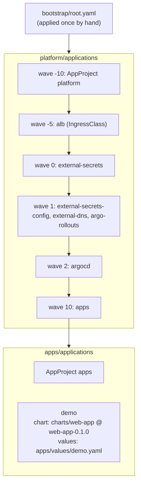

# eks-gitops

GitOps setup for an existing EKS cluster, managed by Argo CD. One commit to this repo installs the cluster add-ons and deploys the applications, and every app ships with progressive delivery: a canary that shifts ALB traffic in steps and rolls back by itself if the new version isn't healthy.

It covers two things:

- **Platform**: Argo CD (managing itself), External Secrets, ExternalDNS, Argo Rollouts and the ALB IngressClass, installed with the app-of-apps pattern and sync waves.
- **Apps**: a reusable Helm chart (`charts/web-app`) and a `demo` app deployed from it.

## How it fits together



Each wave waits until the previous one is healthy, so the apps never sync before the Rollout and ExternalSecret CRDs exist. That only works because of a custom health check for `Application` resources in [argocd values](platform/values/argocd.yaml): out of the box Argo CD doesn't report the health of child Applications, and the waves don't wait at all.

## Layout

```text
bootstrap/root.yaml          app-of-apps, applied once by hand
platform/
  applications/              one Application per add-on
  values/                    Helm values of each add-on
  manifests/                 plain YAML (IngressClass, ClusterSecretStore)
apps/
  applications/              AppProject + one Application per app
  values/                    values of each app
charts/web-app/              Helm chart used by the apps
scripts/                     chart validation and release tags
examples/github-actions/     CI for the charts (reference, not enabled)
```

## Prerequisites

The cluster is expected to exist already, in **EKS Auto Mode** (the IngressClass uses its built-in ALB controller). On the AWS side you need:

| What | Used by |
|------|---------|
| Route 53 public hosted zone | ExternalDNS |
| ACM certificate for the domain (wildcard is easiest) | ALB IngressClass |
| Pod Identity association: namespace `external-dns`, service account `external-dns`, with Route 53 permissions | ExternalDNS |
| Pod Identity association: namespace `external-secrets`, service account `external-secrets`, with `secretsmanager:GetSecretValue` | External Secrets |

Values tied to the environment, to replace before bootstrapping:

| Value | File |
|-------|------|
| Domain (`example.com`) | `platform/values/argocd.yaml`, `platform/values/external-dns.yaml`, `apps/values/demo.yaml` |
| ACM certificate ARN | `platform/manifests/alb/ingressclass.yaml` |
| Region | `platform/values/external-dns.yaml`, `platform/manifests/external-secrets/cluster-secret-store.yaml` |
| Cluster name (`txtOwnerId`) | `platform/values/external-dns.yaml` |
| IPs allowed to reach Argo CD | `platform/values/argocd.yaml` |
| Repo URL | every file in `platform/applications`, `apps/applications` and `bootstrap/` |

## Bootstrap

```bash
# 1. Argo CD, same version and values as platform/applications/argocd.yaml
helm repo add argo https://argoproj.github.io/argo-helm
helm upgrade --install argocd argo/argo-cd --version 10.18.0 \
  --namespace argocd --create-namespace --wait \
  -f platform/values/argocd.yaml

# 2. Root app-of-apps. From here on everything comes from git
kubectl apply -f bootstrap/root.yaml

# 3. Check
kubectl -n argocd get applications
kubectl -n apps get rollout,ingress
```

Once the `argocd` Application syncs, Argo CD manages its own upgrades: bumping `targetRevision` in [argocd.yaml](platform/applications/argocd.yaml) is enough.

Initial admin password:

```bash
kubectl -n argocd get secret argocd-initial-admin-secret -o jsonpath='{.data.password}' | base64 -d
```

This repo is public, so Argo CD reads it without credentials. For a private repo, add a `repo-creds` Secret (a GitHub App works best) and manage it with an `ExternalSecret` so the key never lives in git.

## Deploying a new version

The image tag lives in `apps/values/<app>.yaml`. A CI pipeline in the app repo would open a PR changing it; here you can do it by hand:

```bash
# apps/values/demo.yaml
image:
  tag: yellow
```

After the merge, Argo Rollouts sends 20% of the traffic to the new version, waits 2 minutes, goes to 50%, waits again and then promotes it. The `rollouts-demo` image paints the page with its color, so the split is visible in the browser.

```bash
kubectl argo rollouts get rollout demo-web-app -n apps --watch
kubectl argo rollouts abort demo-web-app -n apps      # back to stable right away
```

If the new pods don't become Ready within `progressDeadlineSeconds`, the rollout aborts and the ALB sends all the traffic back to the stable version.

## The web-app chart

A Rollout instead of a Deployment, with everything a canary on ALB needs:

- Two Services (`<app>` and `<app>-canary`) with the same selector. Argo Rollouts adds the pod template hash to each one to split the traffic.
- An Ingress whose backend is `use-annotation`. Argo Rollouts writes the weights into the `alb.ingress.kubernetes.io/actions.<stable>` annotation. That annotation must not be in git: if Argo CD managed it, it would reset the weights in the middle of a canary.
- Optional `ExternalSecret`: every key of a Secrets Manager JSON secret becomes an env var.
- HPA (targets the Rollout), PDB, topology spread across zones and nodes, and a `preStop` sleep so the ALB deregisters the pod before it stops.

### Versioning

Apps never deploy the chart from `main`, they point to a tag `<chart>-<version>`:

```yaml
- repoURL: https://github.com/naktakalah/eks-gitops.git
  path: charts/web-app
  targetRevision: web-app-0.1.0
```

So a change to the chart doesn't reach every app at once. Each app moves to the new version with its own PR, and rolling back the chart is changing the tag back.

The flow is enforced by two scripts, meant to run in CI (see [examples/github-actions](examples/github-actions)):

- `scripts/check-charts.sh <base>` on PRs: lint and template of the changed charts, and fails if their version wasn't bumped.
- `scripts/release-tags.sh` on merge to main: creates the missing `<chart>-<version>` tags, and fails if a chart changed without a new version.

| Change | Bump |
|--------|------|
| Renames or removes a value, changes resource names or selectors | MAJOR |
| New value with a default that keeps the current behavior | MINOR |
| Fix without interface changes | PATCH |

## Design decisions

- **ServerSideApply for add-ons, not for apps.** Add-ons use SSA because some CRDs are too big for client-side apply. Apps don't: with SSA the Service selector is an atomic map, so Argo CD would remove the hash label Argo Rollouts adds and both Services would point to every pod.
- **No prune on the IngressClass.** Deleting it by mistake would leave every Ingress without a load balancer.
- **One shared ALB.** All Ingresses of `alb-public` share a single ALB (`group.name`). Argo CD is restricted with a `source-ip` condition on its listener rule rather than `inbound-cidrs`, which would lock the whole ALB for every app.
- **ExternalDNS only watches Ingresses.** Services aren't filtered by class and could end up publishing internal load balancers in the public zone. With `policy: sync` it only deletes records it created (TXT owner).
- **Restricted app project.** The `apps` project can only deploy to the `apps` namespace and can't create cluster-wide resources besides its namespace.
- **Secrets never in git.** They live in Secrets Manager and reach the pods through External Secrets.
